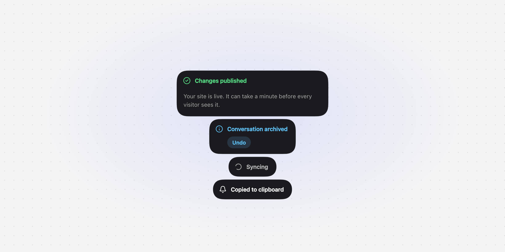
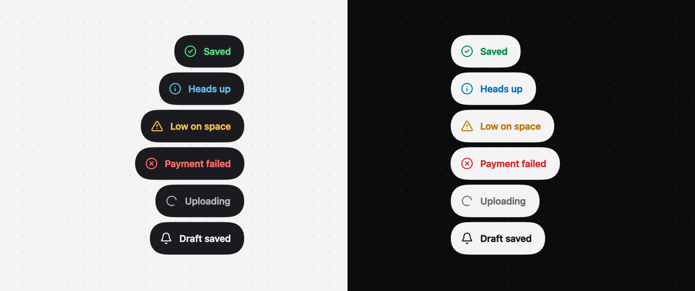

# Seintje

Framework-agnostic toast notifications, with thin adapters for Vue and Svelte.

_Seintje_ is Dutch for "a little heads-up".

<picture>
  <source media="(prefers-color-scheme: dark)" srcset="apps/docs/src/assets/screenshots/hero-dark.png">
  
</picture>

| Package                              | Description                                                      |
| ------------------------------------ | ---------------------------------------------------------------- |
| [`seintje`](packages/seintje)        | The core. Plain TypeScript and DOM, works without any framework. |
| [`@seintje/vue`](packages/vue)       | `<Toaster>` and `useSeintje()` for Vue 3.4+.                     |
| [`@seintje/svelte`](packages/svelte) | `<Toaster>` and a `toasts` store for Svelte 5.                   |

```ts
import { createToaster, seintje } from "seintje";
import "seintje/styles.css";

createToaster(document.body, { position: "bottom-right" });

seintje.success({ title: "Saved", description: "Your changes are stored safely." });
```

All animation runs through the framework-agnostic `animate()` from [motion](https://motion.dev),
its only dependency. The built-in icons are adapted from [Lucide](https://lucide.dev) (ISC).

## Features

- A compact pill that stretches into a full-width card for descriptions, with actions next to or under the title
- Springs that keep their momentum when interrupted
- `seintje.promise()` for loading → success / error flows, with in-place content swaps
- Swipe, close button and <kbd>Escape</kbd> to dismiss; <kbd>Alt</kbd>+<kbd>T</kbd> to focus
- Screen reader announcements through live regions, valid ARIA markup
- Timers that pause on hover, focus and hidden tabs, and resume where they left off
- Respects `prefers-reduced-motion`
- Light, dark and system themes, CSS variables, and per-part classes



## Repository

```
packages/seintje   core library
packages/vue       Vue adapter
packages/svelte    Svelte adapter
apps/docs          documentation site (Astro + Starlight)
apps/playground-*  Vite playgrounds for vanilla, Vue and Svelte
```

```sh
bun install
bun run build          # build the three packages
bun run test           # core tests (bun test) and adapter tests (Vitest)
bun run typecheck
bun run lint
bun run build:docs     # static docs in apps/docs/dist
bun run --filter playground-vue dev
```

Releases are managed with [release-please](https://github.com/googleapis/release-please): it reads
the conventional commits on `master` and keeps a release PR up to date. Merging it creates a GitHub
release for each changed package, publishes them to npm through trusted publishing and deploys the
docs to GitHub Pages.

## Credits

Seintje is inspired by [Sileo](https://github.com/hiaaryan/sileo) by Aaryan, a toast library
for React. Seintje is an independent implementation; it does not contain Sileo's code.

## License

[MIT](LICENSE)
