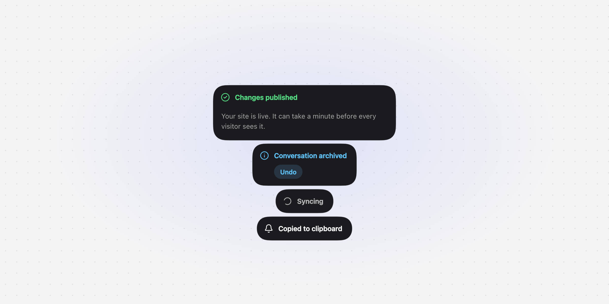

# seintje

Framework-agnostic toast notifications. Works in any page, with or without a
framework. For Vue and Svelte, see [`@seintje/vue`](https://www.npmjs.com/package/@seintje/vue)
and [`@seintje/svelte`](https://www.npmjs.com/package/@seintje/svelte).

<picture>
  <source media="(prefers-color-scheme: dark)" srcset="https://raw.githubusercontent.com/kevinkosterr/seintje/master/apps/docs/src/assets/screenshots/hero-dark.png">
  
</picture>

```sh
npm install seintje
```

```ts
import { createToaster, seintje } from "seintje";
import "seintje/styles.css";

const toaster = createToaster(document.body, { position: "bottom-right", theme: "system" });

seintje.success("Saved");
seintje.error({ title: "Upload failed", description: "The file is larger than 25 MB." });

const id = seintje.loading("Exporting");
seintje.update(id, { type: "success", title: "Exported", duration: 4000 });

await seintje.promise(fetch("/api/sync"), {
  loading: "Syncing",
  success: "Synced",
  error: (err) => ({ title: "Sync failed", description: String(err) }),
});
```

Without a bundler:

```html
<link rel="stylesheet" href="https://cdn.jsdelivr.net/npm/seintje/dist/styles.css" />
<script type="module">
  import { createToaster, seintje } from "https://cdn.jsdelivr.net/npm/seintje/dist/browser/seintje.js";
  createToaster(document.body);
  seintje.info("Hello");
</script>
```

`description` and `icon` accept text, a DOM node, or a renderer `(slot) => cleanup`.

Animation is powered by the framework-agnostic `animate()` from [motion](https://motion.dev);
icons are from [Lucide](https://lucide.dev) (ISC).

Inspired by [Sileo](https://github.com/hiaaryan/sileo). MIT licensed.
